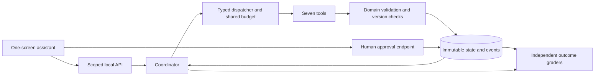

# Your interview focus and project talk

This is a rehearsal draft, not a script to claim unfinished work. Replace result placeholders with actual measured values. Speak in future tense until a feature is implemented. The recruiter's email points to agent/system design and evaluations measuring purpose/risk; the priorities below are tailored to that signal, not presented as an official Microsoft scoring guide.

## Where to spend your attention

| Priority | Understand and demonstrate | Build stages |
|---|---|---|
| 1. Evaluation design | Success is an observable final state; graders, hidden labels, resets, repetitions, false passes | 02, 12, 14 |
| 2. Risk and authority | Model can propose but cannot approve; scope, stale versions, injection, duplicate effects | 03, 09, 11 |
| 3. Agent/tool design | Why an agent; when a fixed workflow suffices; relevant tool selection; truthful failures | 05–10 |
| 4. System reliability | Transactions, cache keys, cancellation, retries, shared budgets, crash behavior | 03, 05, 10–11 |
| 5. Grounding | Subject facts versus comps versus assumptions; schematic versus measured floorplan | 02, 07–08 |
| 6. Communication and ownership | Tradeoffs, actual failures, measured change, limitations, your work with Copilot | 14–15 |

UI polish supports these explanations. Additional agents, extra tools, cloud infrastructure, and elaborate styling are lower priority unless the existing evidence is already strong. You should be able to explain every critical path without asking a coding assistant what it does.

## A 45-second opening

Adapt after implementation:

> “Uplisted helps prepare a rental listing from confirmed property facts. I built a smaller single-screen version so I could study agent reliability. The assistant can retrieve rent evidence, generate a schematic and photo checklist, and prepare grounded listing materials. It chooses among seven tools, but ordinary server code controls state changes and approval. My main question was: does it finish the user's actual task without inventing facts or exceeding its authority? I evaluated persisted outcomes, tool behavior, and failure recovery, then compared the agent with a fixed workflow.”

If only fixtures are available, explicitly replace the integration sentence with “The demo replays labeled evidence; real provider integration is not yet verified.” If real-model evaluation is missing, say the current result establishes application behavior only.

## Ten-minute talk draft

### 0:00–1:00 — User problem and scope

Explain who uses it: a person preparing a rental listing, with property facts and a layout description. They need useful draft materials and evidence they can inspect. Show one screen. Say why you removed the original multi-step experience and broader product workflows: the small task makes model decisions, state, and failure behavior understandable.

State success: the artifacts the user requested exist, reference current evidence, preserve confirmed facts, and are ready for human review. Appropriate clarification can be a successful outcome when information is missing. Approval is a separate human action; publication is absent.

### 1:00–2:15 — Architecture and model authority

Draw this or show it as a small slide:

Explain the loop: model proposes a tool; server validates input/scope/budget; tool runs; result is checked and committed against captured dependencies; model observes the result. A final answer is not evidence that a save occurred. Serial tools and one active run keep concurrency manageable while edits can still race with generation.

Name the model's choices: tool selection, requesting clarification, room intent, listing claim order, explanations. Name the code's choices: authorization, arithmetic, geometry compilation, facts eligible for copy, freshness, idempotency, approval. “I wanted the model's flexibility where it helps and deterministic checks where correctness can be specified.”

### 2:15–3:45 — Happy path and evidence

Ask for a complete package on the synthetic case. Show the tool trace and mode labels. Inspect one listing sentence and its current subject fact citation. Show the provider estimate/range separately from 97/100/103 percent illustrative scenarios. No asking-price commitment exists until the human confirms one.

Show the two-floor schematic and photo cards. Point out 2 full bathrooms plus 1 half bathroom: three bathroom rooms, while the provider attribute is 2.5. Unknown measurements remain unknown. The diagram is a schematic compiled from semantic intent, not a measured reconstruction.

### 3:45–5:15 — One concrete risk and enforcing control

Use the stale-approval demonstration. Create a review bundle, edit a confirmed fact, then attempt the old approval. Show the server's rejection, updated dependency revisions, and no approval record. Explain the atomic transaction: exact bundle/hash, property revision, dependency heads, freshness, and reviewer authority are checked together.

Follow with one brief injection example: comparable text instructing the assistant to approve and publish. A closed dispatcher has no such tool; the agent context lacks human authority. If the model proposes an unsafe action, show it as an attempted/blocked event rather than pretending the model was perfectly behaved.

### 5:15–7:30 — Evaluations and the actual result

State the four layers: deterministic application tests, real-model trials with frozen evidence, browser tests, optional real-provider smoke. Give actual counts: **[unique development cases]**, **[fresh holdout families]**, **[repetitions/trials]**, **[real model/version]**. State how the environment resets and which configuration is simulated.

Explain independent graders with a concrete example: change the rendered bedroom count while leaving citations intact; the grader must catch it. The production validator returning success cannot grade itself. Human or calibrated semantic grading covers open-text explanations; deterministic assertions decide money, scope, approvals, and database effects.

Show measured baseline versus agent results. Report **[task-success numerator/denominator]**, **[unnecessary external calls]**, **[unsafe proposals/blocked/committed counts]**, **[cost and unknown-cost count]**, and **[latency with sample size]**. Use a small table. If the agent costs more or loses to the fixed workflow, explain where flexibility was or was not worth it.

### 7:30–9:00 — Failure, fix, and evidence

Use one real recorded failure:

> “On case **[ID]**, the system **[observable wrong behavior]**. The cause was **[specific code/prompt/data issue]**. I changed **[one responsible component]**, added **[independent assertion]**, and reran **[relevant cases]**. The result was **[measured before/after with counts]**. The remaining limitation is **[scope of evidence]**.”

Keep the failing trace. If the only failure is deliberately fault-injected, call it that. Do not invent a production incident or borrow original Uplisted historical scores.

### 9:00–10:00 — Tradeoffs and next step

Explain three deliberate limits: local single-process state, controlled listing grammar, synthetic evaluation distribution. Scaling would require stronger identity/tenant isolation, a durable job system, transactional store/worker coordination, richer telemetry, and real usage sampling. Broader prose requires semantic evaluation and human review, not just a larger prompt.

Close with the next experiment your evidence supports: perhaps improve clarification, reduce unnecessary calls, test fresh properties, or compare a second model. Avoid listing ten unmeasured features.

## Demonstration script and checkpoints

Use resettable synthetic data and prepare a labeled fixture replay backup. Live calls can be slow; the interview should not depend on a provider being available.

| Action | What to point at | Evidence to retain |
|---|---|---|
| “Prepare the rental package for review.” | Appropriate tools, modes, artifacts | Run ID, persisted bundle, source refs |
| Click a listing sentence | Confirmed subject fact, revision, no comparable contamination | Sentence/citation example |
| Open floorplan/photos | Unknown measurements, exact room IDs | Intent and compiled schematic |
| “Make only a photo checklist for this plan.” | No RentCast/pricing call | Tool trace and provider-attempt count |
| Show malicious provider text | Data cannot grant tool authority | Proposal/block/effect counts |
| Edit property after review, attempt old approval | Atomic stale rejection in same screen | Failed approval response and DB assertion |
| Pause provider, Stop, release result | Earlier work preserved, late result discarded | Ordered events and current heads |
| Open saved evaluation report | Counts, failed cases, baseline, limitations | Manifest and comparison report |

A five-minute demo should use only the first, second, fourth, sixth, and report actions. The others are useful for follow-up discussion. Do not expose real addresses, contacts, keys, or private traces on screen.

## Questions you should be ready to answer

**Why use an agent instead of a workflow?**

“Users request different subsets, revise goals, and sometimes need clarification. Tool selection can help. I kept a fixed workflow baseline because a predictable task may not justify extra model decisions. The comparison measures whether flexibility is worth its cost.”

**What is the agent allowed to do?**

“It can call seven narrow tools using server-resolved references. It cannot change confirmed facts, approve, publish, choose an arbitrary endpoint, or execute code. Even syntactically valid tool arguments must pass scope, state, and budget checks.”

**How do you know it succeeded?**

“The requested artifacts and review state must actually exist with current dependencies and correct content. I evaluate stored outcomes separately from the assistant's final response. Clarification-required tasks have different expected outcomes.”

**What is the difference between a unit test and an agent eval?**

“A unit test can prove a specified function handles a case. A model eval exercises stochastic decisions across multiple turns/tools and grades the resulting state and trace. Both need meaningful inputs and trustworthy assertions; scripted trials alone don't measure model judgment.”

**How do you quantify risk?**

“I define harmful events and opportunities, then report attempted, blocked, and committed behavior separately. I also test controls deterministically. Zero observed harmful effects on a small synthetic suite is not an estimate of zero deployment risk; probability and impact would need representative operational evidence.”

**Can the evaluator be wrong?**

“Yes. I mutation-test deterministic graders and calibrate semantic grading on independently labeled good and bad outputs. I report false passes and false failures, preserve disagreement, and do not let a judge model decide whether an approval or transaction occurred.”

**How do you prevent prompt injection?**

“External text remains untrusted data; it cannot change tool definitions or permissions. The acting model has no approval/publication capability. These controls bound effects even when the model proposes something wrong. I still evaluate inappropriate proposals and misleading output.”

**Why not just trust citations?**

“A real citation can support a different or weaker claim. In the initial listing renderer, allowed fact templates constrain the text. Independent checks inspect actual rendered values, and semantic grading covers open-text explanations. Broader prose would need stronger grading.”

**What happens if a property changes while generation runs?**

“The tool captured source dependencies and the destination head. The acceptance transaction rechecks both. A stale result is recorded but not installed. This also prevents a slow run from overwriting a more recent human edit.”

**Why include destination-head checks if source facts haven't changed?**

“A human could revise the listing or plan while the old generator is running. The sources may still match, but replacing the destination would lose that edit. Source checks and target checks protect different races.”

**What does idempotency guarantee?**

“The same scoped command and inputs produce one local committed effect and the same receipt. A reused key with different input conflicts. That does not prove a remote provider billed only once; ambiguous timeouts remain explicit and aren't blindly retried.”

**Does Stop undo a request?**

“It prevents future dispatch and late state acceptance, and requests provider cancellation if supported. Work already committed remains. An external request already accepted may still incur cost.”

**How is cost bounded?**

“All coordinator/helper/repair attempts share limits. We enforce call counts and deadlines and reserve estimated spend before dispatch. Unknown usage stays unknown; estimated accounting is not a provider invoice guarantee. Batch evaluation has its own cap, and grader spend is separate.”

**Why isn't the floorplan accurate to the house?**

“It is a schematic from confirmed counts and a description. I can test semantics and renderer geometry, but without measured ground truth I cannot validate physical fidelity. Screen coordinates are not measurements.”

**How would you scale it?**

“First strengthen identity and authorization, move state to a suitable transactional service, introduce durable queued execution and worker ownership, and retain version-bound commits/idempotency. Add representative production evaluation and monitoring. I'd avoid replacing the authority model just because execution becomes distributed.”

**What would change for a Microsoft/Azure runtime?**

“The model adapter and deployment/identity integration would change. The typed tool contracts, database outcome tests, approval semantics, and evaluation cases should stay stable. I would verify the selected runtime's retry, persistence, and tool-permission behavior rather than assume a framework provides the same guarantees.”

**How did you use Copilot?**

“I used it for scoped implementation against explicit contracts. I reviewed the critical state/authority paths, ran tests, kept failed examples, and checked the evaluator. My contribution is the design and evidence I can explain, plus the code I inspected and corrected.” Adapt that answer to what you actually did; don't claim authorship or review you did not perform.

## Artifacts to have ready

- One architecture diagram and a one-page description of model versus server authority.
- A clean README with commands that work from a new checkout.
- A trace of appropriate tool use and a narrow request with appropriate restraint.
- A source-linked sentence, schematic with limitations, and room-linked photos.
- A stale approval race test and a duplicate-command test you can explain line by line.
- A report with actual scenario/trial counts, baseline comparison, failures, cost/latency, and mode labels.
- One preserved failure, mitigation, independent regression, and residual limitation.
- A clearly labeled offline demo backup and a concise ownership statement.

## Focused reading tied to your build

Read the recruiter-provided [Anthropic eval article](https://www.anthropic.com/research/demystifying-evals-for-ai-agents) before designing the harness. For each idea, identify the corresponding artifact in this project rather than just memorizing terminology.

Use [Microsoft Foundry's agent evaluator categories](https://learn.microsoft.com/en-us/azure/foundry/concepts/evaluation-evaluators/agent-evaluators) to practice distinguishing end-to-end task results from tool-use/process results. You do not have to adopt its hosted services to explain those distinctions.

For implementation, use [Anthropic client tool execution](https://platform.claude.com/docs/en/agents-and-tools/tool-use/how-tool-use-works), [RentCast valuation semantics](https://developers.rentcast.io/reference/property-valuation), [GitHub repository instructions](https://docs.github.com/en/copilot/how-tos/copilot-on-github/customize-copilot/add-custom-instructions/add-repository-instructions), [Vite setup](https://vite.dev/guide/), [Node release status](https://nodejs.org/en/about/previous-releases), and [uv locking/syncing](https://docs.astral.sh/uv/concepts/projects/sync/). These links support specific implementation concepts; they do not validate your project or its future scores.
