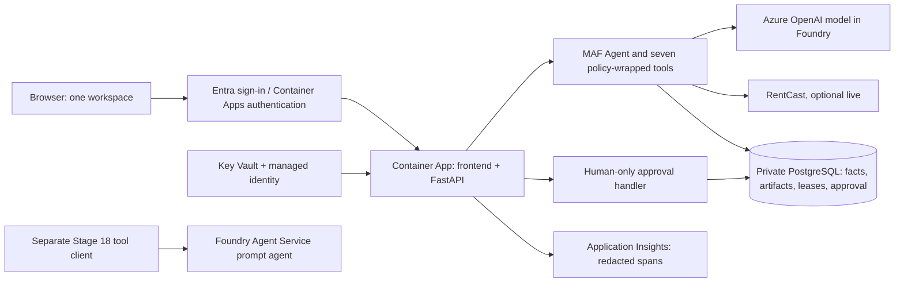

# Azure architecture and deployment contract

Updated November 8, 2026. **Azure is a required target for this prototype.** The earlier version was local-only; there is no AWS deployment to migrate. These instructions replace the earlier SQLite/direct-Anthropic/no-cloud decisions. They do not create Azure resources by themselves.

## What you will build and learn

The main application uses Microsoft Agent Framework hosted in FastAPI on Azure Container Apps. MAF owns model/tool orchestration; application services own budgets, permissions, transactions and human approval. Stage 18 compares it with a managed Foundry Agent Service prompt agent. Follow [the MAF contract](08-microsoft-agent-framework.md).

Keep the same one-screen interface and seven domain tools. Azure changes identity, hosting, persistence, model access, telemetry, and operational tests; it does not grant the model extra authority.

| Component | Required choice | Learning purpose |
|---|---|---|
| Local development | React/Vite + FastAPI + PostgreSQL 16 in Docker Compose | Same database semantics locally and in Azure |
| Model inference | Azure OpenAI Responses API, Azure deployment name, Entra credentials | Distinguish endpoint, deployment, identity, and tool execution |
| Browser/API hosting | One container image with built frontend assets served by FastAPI on Azure Container Apps | One HTTPS origin, reproducible artifact and revisions |
| State | Azure Database for PostgreSQL Flexible Server | Durable state independent of container lifetime |
| Human identity | Container Apps authentication with single-tenant Microsoft Entra ID, then application allowlist/case authorization | Sign-in and permission are separate checks |
| Workload identity | User-assigned managed identity | Access models, database, Key Vault, and registry without model/API keys in code |
| Secrets | Key Vault references for RentCast and the browser authentication configuration where a secret is required | Secret scope, lifecycle, and rotation |
| Images | Azure Container Registry | Deploy a built image digest, not source folders or moving tags |
| Observability | OpenTelemetry to Application Insights/Log Analytics; durable audit events in PostgreSQL | Correlated diagnostics versus authoritative records |
| Infrastructure | Reviewed Bicep and parameter files plus Azure CLI | Repeatable provisioning, what-if, updates and cleanup |
| Managed-agent lab | Foundry project and one versioned prompt agent | Learn what the managed service owns and what your tool client still owns |

This is a small development deployment, not a claim of production certification. Microsoft documents Container Apps with PostgreSQL and managed identity as a supported Python architecture. [Azure deployment tutorial](https://learn.microsoft.com/en-us/azure/developer/python/tutorial-deploy-python-web-app-azure-container-apps-01).



## Environments and incremental provisioning

`APP_ENV=local` uses scripted/fixture providers and a loopback PostgreSQL container. `APP_ENV=azure` requires cloud authentication, PostgreSQL over verified TLS, and managed identity. `MODEL_MODE=scripted|live` and `RENTCAST_MODE=fixture|live` remain separate flags. The first deployed smoke runs scripted/fixture; the required final Azure model smoke uses live Azure inference with synthetic frozen evidence. Live RentCast remains optional and requires an authorized real subject.

Stage 13 may provision only the Foundry/model resources needed for Azure inference and the later lab, after account/region/model/spend choices are available. Stage 16 defines the rest of the infrastructure. Stage 17 applies it and verifies the deployed app. Do not wait until the last stage to discover that the subscription cannot deploy the selected model.

The owner supplies subscription, tenant, resource group, allowed regions, model deployment choice/quota, permitted reviewer identity, cost limits, and expiry in [AZURE-OWNER-SETUP.md](AZURE-OWNER-SETUP.md). Resolve versions and availability from the current subscription and official docs; do not invent model/SKU availability or a monthly price. Missing cloud access does not block local stages, but it does leave the Azure milestone incomplete.

This revision authorizes changing instructions, not creating billable resources now. When the owner later asks Copilot to execute a cloud stage, use the supplied scope and limits; do not ask for the same authorization repeatedly. If required account/permission/budget choices are missing, present the concrete prepared deployment and ask for only those missing choices. A generic “start” executes the first incomplete stage, beginning with Stage 00.

## Model API and endpoint contract

Implement `build_live_client` in `providers/azure_openai_gateway.py` using the installed MAF Responses provider and azure-identity. Current Python documentation uses `agent_framework.openai.OpenAIChatClient`; configure explicit Azure routing and the actual Azure deployment name as model. For a full `/openai/v1/` URL use base_url, not azure_endpoint. Verify token audience, async credential support and API-surface configuration against the pinned provider version. Do not build a parallel direct-SDK orchestration loop. Keep retries disabled, hosted tools unregistered, and cloud identities explicit. [Current Microsoft Python provider guide](https://learn.microsoft.com/en-us/agent-framework/integrations/by-component/model-providers/openai).

Use local Azure CLI credentials for authorized development, an explicit user-assigned managed identity in Azure, and resource-scoped `Cognitive Services OpenAI User` for direct inference. For a registry configured without repository-ABAC, use scoped `AcrPull`; use `Key Vault Secrets User` at the intended vault/secret scope. If registry authorization mode differs, verify the corresponding repository-read role rather than granting broad Contributor. Provisioning privileges are separate from inference privileges. Do not ship Azure API keys or allow a production credential chain to fall back to a developer's cached identity. Keep retries disabled and account for each request. [Identity and RBAC](https://learn.microsoft.com/en-us/azure/foundry/concepts/authentication-authorization-foundry).

Keep per-run MAF session/provider continuation separate from public messages and use it to preserve tool-call IDs and Responses `function_call` / `function_call_output` semantics. Retain provider-returned continuation items required by the chosen model, including opaque reasoning items when needed for the protocol, without displaying or exporting private reasoning. Use application-managed conversation and `store=false` where supported; verify that choice for the deployed model. Do not send seven Python implementations to Azure and assume Azure executes them. Validate tool proposals and outputs in the existing dispatcher. Structured helper output remains subject to independent domain checks.

Record deployment name, model/version, endpoint class, SDK version, region, model capabilities, request settings, and prompt hash in the evaluation manifest. Re-run capability smoke tests if any changes. Do not use deprecated/classic SDK tutorials as a new starting point; current Microsoft docs distinguish direct model, project, and managed-agent SDK paths. [SDK selection guide](https://learn.microsoft.com/en-us/azure/foundry/how-to/develop/sdk-overview).

## Durable database and run ownership

Use PostgreSQL 16 locally and in Azure; pin a compatible patch/image digest locally during Stage 01. Use `psycopg` 3 and a small bounded pool. Keep repository contracts and canonical hashes independent of database JSON ordering. Explicit numbered SQL migrations run under a migration identity; the app identity can only perform necessary data operations. Do not use the runtime identity for schema changes or superuser access.

Local Compose exposes PostgreSQL only on loopback. Tests use a disposable database/schema with a test identity and reset every trial; test cleanup rejects a non-test database/schema. External network remains blocked during offline tests, with loopback access allowed for this database. Azure uses a VNet-integrated Container Apps environment, private PostgreSQL networking/private DNS, public database access disabled, and verified TLS. Use Entra database authentication with a fresh token when opening a pooled connection; do not freeze one startup token into a long-lived connection factory. [PostgreSQL security](https://learn.microsoft.com/en-us/azure/postgresql/security/security-overview).

Container files are scratch space, not authoritative state. Do not deploy a SQLite database on container storage or Azure Files. Reports needed by the UI can be a bounded redacted JSON projection stored in PostgreSQL; larger exports can remain local evaluation artifacts. Blob storage is a later extension, not required for this prototype.

Run ownership must be durable even with one replica: Container Apps can overlap old/new revisions during deployment. [Revision lifecycle](https://learn.microsoft.com/en-us/azure/container-apps/revisions).

- Each active run stores `owner_id` (process instance UUID), `fence` (monotonic case generation), and `lease_expires_at` in PostgreSQL. Enforce at most one queued/running run per case with transactional admission and a partial unique index.
- Claim and increment the case fence atomically. Renew a 30-second lease every 5 seconds while running, using database time; all long provider calls must leave the event loop responsive. Queued runs also have bounded ownership, so they cannot remain active indefinitely after process death.
- Before every external dispatch and every artifact/review commit, require the current owner/fence, unexpired lease, active state, and no cancellation. DB authority overrides an in-memory task flag. Reservations are scoped to that run/fence.
- On lease loss, stop new work and reject late results. No provider request is replayed automatically. A network call already accepted may still complete or be billed.
- Startup/reconciliation marks **only expired** owned work interrupted using an atomic predicate; it never interrupts another healthy revision's run. A new user retry gets a new run/fence. Expired-run transitions emit durable events.
- Keep transaction scopes short; never hold a row lock while awaiting a model/provider call. Use a consistent lock order for case, run, destination head and review rows.

The app still uses one Uvicorn worker, one active revision, `minReplicas=1`, `maxReplicas=1`, serial tools, and no job queue. The lease/fence exists for overlap and failure safety, not a claim of a complete durable workflow engine. In-flight work can become interrupted after a crash; accepted artifacts survive.

## Human sign-in versus application authority

Container Apps authentication requires single-tenant Entra sign-in and HTTPS. Configure it before exposing a usable app endpoint. The application consumes platform-authenticated identity only behind this protected ingress and maps `(tenant_id, object_id)` to an allowlisted reviewer and case. Require an explicit case membership/role; sign-in alone is insufficient. Test a signed-in but unlisted user. [Container Apps authentication](https://learn.microsoft.com/en-us/azure/container-apps/authentication).

`APP_ENV=azure` rejects the local seeded-session mode at startup. Human API actions derive identity from the authenticated request, never JSON `actor_id`, claimed role, or chat text. Retain CSRF and origin checks for cookie-based mutations. Store app-session state in PostgreSQL so a restart does not silently rebind it to a different actor. Validate audience/tenant in the configured authentication layer and reject missing/untrusted principal context. No direct public backend bypass is allowed.

Use Entra object IDs, not display names/emails, for the allowlist. Managed identity identifies the **workload**, not the human approving a listing. The model runtime context still lacks approve/confirm-property permission. Keep these three identities separate in code and explanation.

Application registration/bootstrap requires directory permissions beyond ordinary resource deployment. Document it as a separate step; reuse an owner-supplied registration if necessary. If a client secret is needed for browser authentication, store it as a Key Vault-backed app secret, record its expiry/rotation procedure, and never echo it into command logs or Bicep outputs. Do not disable authentication to work around a missing permission.

## Infrastructure and deployment sequence

Implement these files during the corresponding stages; they are not deployed artifacts in this handoff:

```text
Dockerfile, .dockerignore, compose.yaml
infra/model.bicep, infra/main.bicep, infra/main.parameters.example.json
infra/modules/{identity,network,database,registry,monitoring,secrets,app}.bicep
scripts/azure/preflight.sh, what-if.sh, deploy.sh, smoke.sh, teardown.sh
docs/AZURE-DEPLOYMENT.md, docs/AZURE-DEPLOYMENT-RESULTS.md
```

1. Preflight the exact tenant/subscription and dedicated resource group; verify permissions, quotas, region/model availability, Bicep/CLI versions, Docker, and a dated cost estimate. Do not register providers or create resources as an incidental read-only check.
2. Build/validate/lint Bicep locally. Once authorized account access exists, run Azure what-if and inspect replacements/deletions. Keep model deployment parameters distinct from a model catalog name.
3. Provision identity, VNet/private DNS, PostgreSQL, ACR, Key Vault, monitoring, and the app environment with the agreed parameters. Reconcile the Stage 13 Foundry resource without duplicating it. Budget alerts and owner/expiry tags belong in the plan.
4. Configure Entra registration/authentication and least-privilege grants; initialize the database through a migration/bootstrap path that has private network access. Use a manually triggered one-shot Container Apps migration Job with a separate migration identity, or a documented approved private-network runner. It is deployment tooling, not the agent's background queue. Runtime cannot run DDL.
5. Build a Linux image in ACR or for the platform verified supported by ACA; do not assume a macOS ARM image runs in the selected environment. Use a multistage build, locked dependencies, non-root process, and built Vite assets served by FastAPI. Exclude `.env`, `.tools`, reports and local databases from the build context. Deploy an immutable digest with one worker, port 8000, probes and graceful SIGTERM handling.
6. Run authenticated scripted/fixture smoke against HTTPS, then explicitly enabled Azure-model smoke within the configured cap. Seed a synthetic case for the allowed Entra owner; cloud seed must not create a bypass login. Store actual revision/image/config IDs and test evidence.
7. Test persistence, restart, identity, version races, lease expiry, revision overlap, cancellation and telemetry. Review rollback to the previous compatible image; irreversible schema changes are outside v1. No concurrent migration from both revisions.

Do not run `azd up` or apply a generic sample that creates unreviewed services. The generated deployment scripts should name the chosen resources and parameter files. Optional future GitHub deployment uses federated OIDC and a constrained identity; no long-lived Azure credential in GitHub secrets is needed for this plan. Initial deployment is owner-driven CLI, not auto-deploy on every push.

## Observability, cost, and cleanup

Create request/run/tool/provider spans with trace IDs, case pseudonyms, code/deployment version, timing, retries, outcomes, usage and known/unknown cost. Instrument through the currently supported Microsoft OpenTelemetry distribution and pin the implementation version; avoid freezing an outdated package recipe in this document. Disable prompt/completion and sensitive-content capture by default. Store security-relevant effects durably in PostgreSQL; sampled telemetry is diagnostic evidence, not the approval ledger. [Azure Monitor instrumentation](https://learn.microsoft.com/en-us/azure/azure-monitor/app/opentelemetry-enable?tabs=python).

Before provisioning, record the chosen region/SKUs, approximate always-on costs (database, one app replica, registry, networking, logs), model pay-per-use rates and assumptions. Do not invent a fixed price. Separate application/model/eval-judge/lab spend. Azure budget alerts notify; they are not hard spending caps. Keep existing request/batch limits, modest telemetry retention, owner/expiry tags, and an explicit teardown path. [Budget behavior](https://learn.microsoft.com/en-us/azure/cost-management-billing/costs/tutorial-acm-create-budgets).

The teardown script defaults to a dry-run inventory and only deletes the dedicated, exact resource group after an explicit delete invocation. List Entra registrations/service principals and any intentionally reused/out-of-group resources separately; do not delete shared resources. Export desired reports first. Delete the lab agent/version/conversations using captured IDs. A stopped database is not permanent cleanup; PostgreSQL can restart automatically after seven days. [PostgreSQL stop/start](https://learn.microsoft.com/en-us/azure/postgresql/configure-maintain/how-to-stop-server).

## Required Azure evidence before declaring the prototype complete

- Authenticated HTTPS workspace, same one-screen flow, named Container Apps revision/image digest.
- Anonymous requests cannot read property state or mutate it; signed-in unlisted users are denied; forged principal headers cannot bypass platform authentication.
- Real Azure model tool round-trip and structured output under the same application limits; clear fixture/live labels.
- Accepted artifacts and approval records survive container restart; orphaned runs become interrupted after lease expiry without replay.
- Two process/revision attempts cannot both own or commit a case run; human edits and cancelled/expired owners reject late results.
- Runtime can perform permitted model/database/secret operations, but cannot perform schema administration or acquire human approval authority.
- One run trace is correlated across API, tool, provider and database events; sensitive markers absent from exported diagnostics.
- Reviewed cost estimate, alert configuration, tested dry-run cleanup inventory, rollback instructions, and actual failure/limitation notes.

Offline tests, cloud deployment checks, model-quality trials, and the managed-agent lab remain separate report sections. Completion requires real Azure deployment evidence; a Bicep file or mocked SDK test alone is insufficient.
